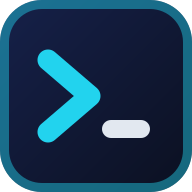
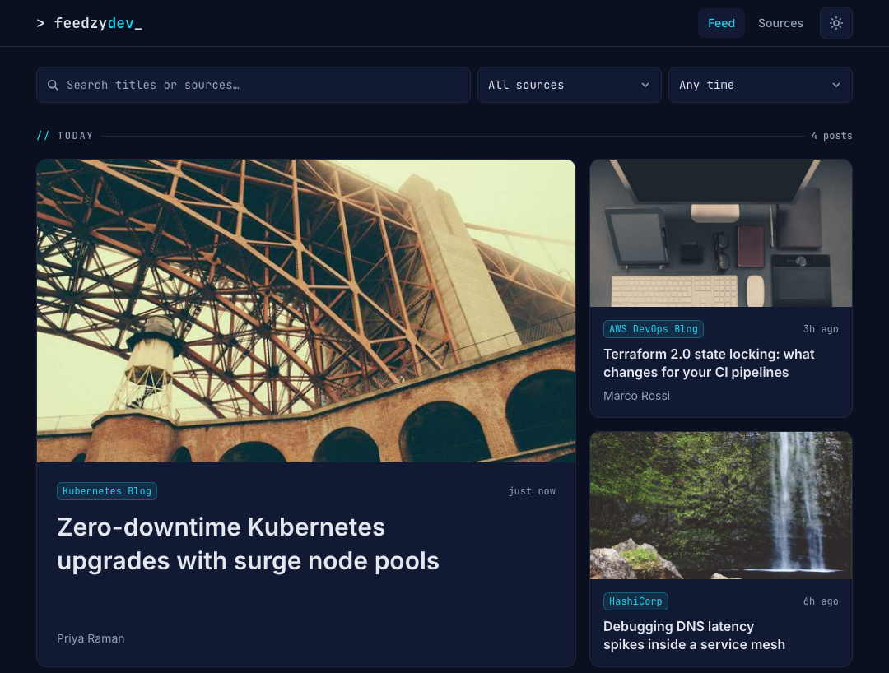
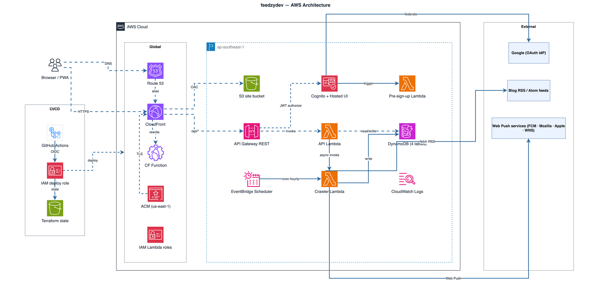

<div align="center">



# feedzydev

**A personal morning feed of new DevOps blog posts, served from a serverless AWS stack.**

[](https://github.com/HuyNguyen260398/feedzydev/actions/workflows/deploy.yml)


[Live site](https://feedzydev.nghuy.link) • [Features](#features) • [How it works](#how-it-works) • [Getting started](#getting-started) • [Deploy your own](#deploy-your-own) • [Documentation](#documentation)



<sub>Feed page running in mock mode, with sample data.</sub>

</div>

## Overview

feedzydev crawls the RSS and Atom feeds of a hand-picked list of sources and shows new posts as scannable cards that link to the original articles. The feed is public. Only the owner can manage sources and trigger a crawl.

## Features

- **Curated sources:** paste a homepage or a feed URL, and feed discovery finds the feed.
- **Scheduled crawls:** choose the crawl hours in the UI (07:00 `Asia/Ho_Chi_Minh` by default), or click **Crawl now**.
- **Scannable cards:** each card shows a thumbnail, title, author, date and source. Posts without an image get a thumbnail drawn in a per-source theme.
- **Search and filters:** search titles and sources, filter by source or date, and scroll through results without paging.
- **Push notifications:** anyone can turn on the header bell to get a Web Push notification when a crawl finds new posts.
- **Installable PWA:** add it to a phone or desktop, in a light or dark theme.
- **Adjustable limits:** set posts per source (1–50, default 5) and retention (up to 365 days or forever, default 90 days).
- **Owner-only admin:** Google sign-in through Cognito, restricted to a single allowed email.

## How it works



1. **Serve:** CloudFront is the single entry point. It serves the Next.js static export from a private S3 bucket and forwards `/api/*` to API Gateway, so the frontend needs no CORS.
2. **Read:** public requests reach the API Lambda, which reads posts and sources from DynamoDB.
3. **Crawl:** EventBridge Scheduler invokes the crawler Lambda every hour, and it exits early unless the current hour is a saved crawl hour. A failing source is recorded and skipped without aborting the crawl.
4. **Notify:** after a full crawl with new posts, the crawler sends VAPID-signed pushes to subscribers and removes endpoints that have gone away.
5. **Administer:** write routes require a Cognito JWT, and the API Lambda also checks that the token's email is the allowed one.

| Layer          | Technologies                                                               |
| -------------- | -------------------------------------------------------------------------- |
| Frontend       | Next.js 15 static export, React 19, Tailwind CSS 4, AWS Amplify            |
| Backend        | TypeScript Lambdas on Node.js 24 (arm64), DynamoDB, `web-push`             |
| Infrastructure | CloudFront, S3, API Gateway, Cognito, EventBridge Scheduler, Route 53, ACM |
| Delivery       | Terraform, GitHub Actions with OIDC (no long-lived AWS keys)               |

## Getting started

You need [Node.js](https://nodejs.org) 24 (pinned in `.nvmrc`) and [pnpm](https://pnpm.io) (pinned by `packageManager` in each package). The UI runs on built-in mock data, so you don't need an AWS account:

```bash
git clone https://github.com/HuyNguyen260398/feedzydev.git
cd feedzydev/frontend
pnpm install
NEXT_PUBLIC_MOCK=1 pnpm dev
```

Then open <http://localhost:3000>.

To use a real backend instead, copy the variables in [`frontend/.env.example`](frontend/.env.example) into `frontend/.env.local` and fill them in.

> [!WARNING]
> Never set `NEXT_PUBLIC_MOCK` in CI or deploy builds.

### Project layout

```text
backend/    Lambda functions: API, crawler, Cognito pre-sign-up
frontend/   Next.js app: feed (/) and owner admin (/sources)
infra/      Terraform: bootstrap, envs/prod and reusable modules
docs/       Architecture, tech stack, runbook and diagrams
```

### Quality gates

`backend` and `frontend` are separate packages with no root `package.json`, so run commands inside each one. These are the same checks CI runs on pull requests to `main`:

```bash
(cd backend  && pnpm install --frozen-lockfile && pnpm format:check && pnpm lint && pnpm typecheck && pnpm test && pnpm build)
(cd frontend && pnpm install --frozen-lockfile && pnpm format:check && pnpm lint && pnpm typecheck && pnpm test)
terraform fmt -check -recursive infra
```

CI also builds the frontend, validates Terraform and, when `infra/**` or `backend/**` changed, runs `terraform plan` with a read-only OIDC role.

## Deploy your own

> [!IMPORTANT]
> Deploying creates real AWS resources. Usage-based pricing keeps idle cost near zero, but see [Tear down](#tear-down) when you are done.

You need:

- AWS CLI access to the target account with admin rights (first apply only)
- Terraform 1.15 (CI pins 1.15.5)
- An authenticated `gh` CLI
- A Route 53 hosted zone
- A GitHub OIDC provider already present in the account

> [!NOTE]
> The Terraform defaults point at the original account, domain and repository. In a fork, first change the defaults in [`infra/bootstrap/variables.tf`](infra/bootstrap/variables.tf) and [`infra/envs/prod/variables.tf`](infra/envs/prod/variables.tf), including `github_sub_prefix`. This repository uses GitHub's immutable OIDC subjects (`repo:owner@id/name@id:...`), and you can read yours with `gh api repos/OWNER/REPO/actions/oidc/customization/sub`.

**1. Bootstrap the state bucket and CI roles:**

```bash
cd infra/bootstrap
terraform init
terraform apply
terraform output   # state_bucket_name, plan_role_arn, deploy_role_arn, permissions_boundary_arn
```

**2. Create a Google OAuth client.** In the [Google Cloud console](https://console.cloud.google.com/), set up the consent screen and add your account as a test user. Then create a **Web application** client with this redirect URI:

```text
https://<cognito_domain_prefix>.auth.<region>.amazoncognito.com/oauth2/idpresponse
```

**3. Generate VAPID keys** with `npx web-push generate-vapid-keys`. Deploys fail without them.

**4. Configure the repository** with `gh variable set` and `gh secret set`:

| Name                   | Kind     | Value                                     |
| ---------------------- | -------- | ----------------------------------------- |
| `AWS_REGION`           | Variable | Target region, such as `ap-southeast-1`   |
| `STATE_BUCKET_NAME`    | Variable | `state_bucket_name` bootstrap output      |
| `ALLOWED_EMAIL`        | Variable | The one Google account allowed to sign in |
| `VAPID_PUBLIC_KEY`     | Variable | VAPID public key                          |
| `AWS_PLAN_ROLE_ARN`    | Secret   | `plan_role_arn` bootstrap output          |
| `AWS_DEPLOY_ROLE_ARN`  | Secret   | `deploy_role_arn` bootstrap output        |
| `GOOGLE_CLIENT_ID`     | Secret   | Google OAuth client ID                    |
| `GOOGLE_CLIENT_SECRET` | Secret   | Google OAuth client secret                |
| `VAPID_PRIVATE_KEY`    | Secret   | VAPID private key                         |

**5. Push to `main`.** The Deploy workflow runs the CI gates, applies Terraform, builds the frontend with the Cognito outputs, syncs it to S3, invalidates CloudFront and smoke-tests `/api/posts`. You can re-run it at any time with **Run workflow**.

**6. Verify the deployment:**

- The site loads over HTTPS on desktop and mobile widths.
- Google sign-in works for the owner and rejects any other account.
- Adding a source and clicking **Crawl now** yields posts.
- Admin endpoints return 401 without a token.

For checkpoints and troubleshooting, follow the step-by-step [go-live runbook](docs/runbooks/go-live.md).

### Starter sources

Paste any of these on the Sources page:

- AWS DevOps Blog: `https://aws.amazon.com/blogs/devops/feed/`
- AWS Containers Blog: `https://aws.amazon.com/blogs/containers/feed/`
- HashiCorp Blog: `https://www.hashicorp.com/blog/feed.xml`
- Kubernetes Blog: `https://kubernetes.io/feed.xml`
- CNCF Blog: `https://www.cncf.io/feed/`
- GitHub Engineering: `https://github.blog/engineering/feed/`
- Grafana Labs Blog: `https://grafana.com/blog/index.xml`
- Docker Blog: `https://www.docker.com/blog/` (feed discovery finds the feed)

> [!TIP]
> Use the per-blog feeds for AWS. Discovery on `https://aws.amazon.com/blogs/` only finds AWS "Recent Announcements", because that page advertises no blog feed of its own.

### Tear down

The commands below use the default resource names, so substitute your own if you changed them.

<details>
<summary>Show the tear-down steps</summary>

**1. Destroy the prod stack.** The site bucket is not `force_destroy`, so empty it first. The Cognito user pool has deletion protection, so temporarily set `deletion_protection = "INACTIVE"` in `infra/modules/auth/main.tf` and apply that change. Avoid `aws cognito-idp update-user-pool`, which resets unspecified settings.

```bash
cd infra/envs/prod
terraform init -backend-config="bucket=feedzydev-claude-tfstate-010382427026" -backend-config="region=ap-southeast-1"
aws s3 rm s3://feedzydev-claude-prod-site-010382427026 --recursive
terraform apply     # applies only the deletion-protection change
terraform destroy   # prompts for the required variables (or use TF_VAR_*)
```

**2. Destroy the bootstrap stack.** The state bucket has `prevent_destroy`, so remove that lifecycle setting from `infra/bootstrap/main.tf` first. Then empty the bucket, including all object versions:

```bash
aws s3api delete-objects --bucket feedzydev-claude-tfstate-010382427026 \
  --delete "$(aws s3api list-object-versions --bucket feedzydev-claude-tfstate-010382427026 \
  --query '{Objects: Versions[].{Key:Key,VersionId:VersionId}}' --output json)"
cd ../../bootstrap && terraform destroy
```

If the bucket also holds delete markers, remove them the same way (`DeleteMarkers[]`).

</details>

## Known behavior

A source's full and short names apply to its posts as soon as they are saved, including posts that were already crawled. Push notifications use the full name the source had when the post was crawled.

Changing a source's URL keeps the posts already crawled from the old feed. They stay until they expire under the retention setting.

## Documentation

| Document                                    | Contents                                                       |
| ------------------------------------------- | -------------------------------------------------------------- |
| [Architecture](docs/architecture.md)        | Diagrams, data model, access patterns, runtime flows, security |
| [Tech stack](docs/tech-stack.md)            | Libraries, service configuration, limits, CI/CD details        |
| [Go-live runbook](docs/runbooks/go-live.md) | First deployment, troubleshooting, rollback                    |
