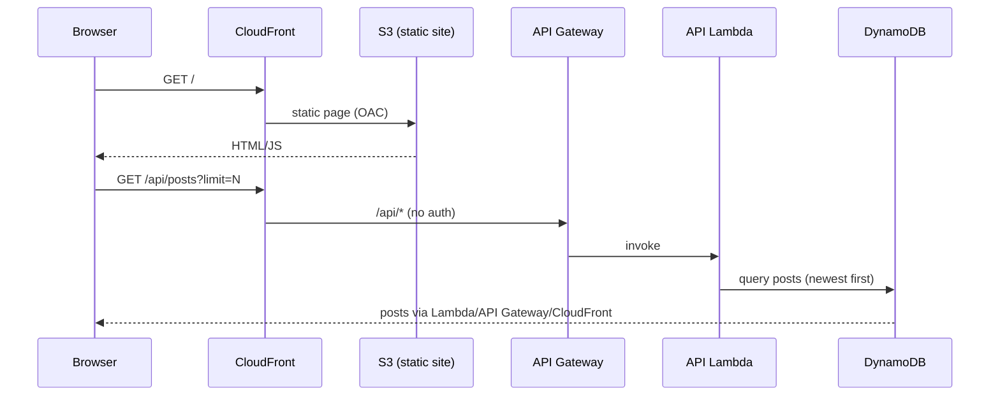
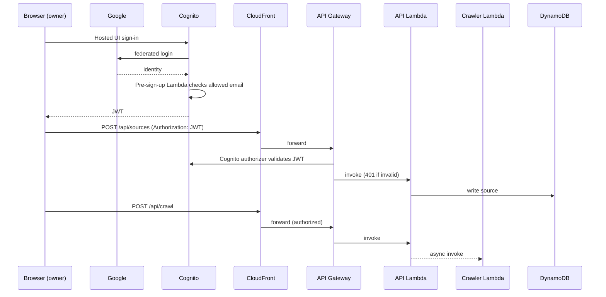
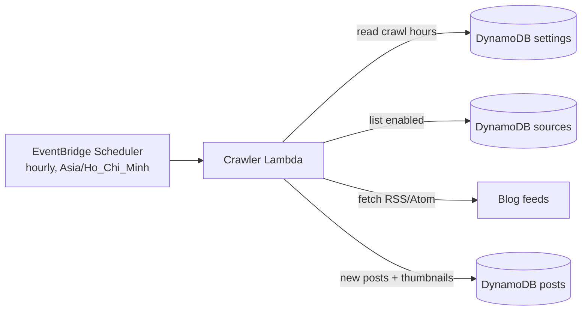
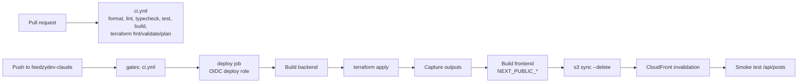

# Architecture

CloudFront is the single entry point (custom domain `feedzydev-claude.nghuy.link`,
ACM certificate in us-east-1). The default behavior serves the Next.js static
export from a private S3 bucket (OAC); `/api/*` forwards to API Gateway, so the
frontend is same-origin with the API and needs no CORS.


Source: [`diagrams/aws-architecture.drawio`](diagrams/aws-architecture.drawio) (open in draw.io).

## Services

| Concern | Service | Role |
|---|---|---|
| Edge / entry | CloudFront + ACM + Route 53 | HTTPS, custom domain, routes static vs `/api/*` |
| Static hosting | S3 (private, OAC) | Next.js static export |
| API | API Gateway REST | Public GETs; write methods behind a Cognito authorizer |
| API compute | Lambda (single function, internal router) | Sources CRUD, posts list, "Crawl now" |
| Crawler | Lambda | Fetches feeds, extracts thumbnails, writes posts |
| Schedule | EventBridge Scheduler | `cron(0 * * * ? *)` (hourly), Asia/Ho_Chi_Minh; the crawler runs only at the crawl hours saved in settings (default 07:00) |
| Data | DynamoDB (sources, posts, settings, push-subscriptions) | On-demand billing |
| Push | Web Push (VAPID) via the `web-push` npm package | Crawler notifies anonymous subscribers after full crawls with new posts |
| Auth | Cognito + Google IdP | Pre-sign-up Lambda allows only the owner's email |
| CI/CD | GitHub Actions + OIDC | Plan role (read-only) and deploy role (branch-scoped) |
| State | S3 (native lockfile) | Terraform remote state |

## Runtime

### Feed read (public)



### Admin write (authorizer)



### Scheduled crawl


Source: [`diagrams/crawl-and-push.drawio`](diagrams/crawl-and-push.drawio). Covers this section and
[Push notification](#push-notification).



The scheduler fires every hour; the crawler exits early unless the current hour is one of the
crawl hours saved in settings (editable from the UI, default 07:00). A failing source is recorded
and skipped; it never aborts the whole crawl.

### Push notification

```mermaid
sequenceDiagram
    participant B as Browser / PWA
    participant API as API Lambda
    participant DS as DynamoDB push-subscriptions
    participant CR as Crawler Lambda
    participant PS as Push service (FCM, Mozilla, Apple, WNS)
    participant SW as Service worker
    B->>API: POST /api/push/subscriptions (bell click, after permission)
    API->>DS: upsert id = sha256(endpoint)
    Note over CR: full crawl (scheduled or "Crawl now") inserted new posts
    CR->>DS: Scan subscriptions
    CR->>PS: VAPID-signed push (newest post title, count)
    PS-->>CR: 404/410 → delete subscription
    PS->>SW: push event
    SW->>B: showNotification; click focuses or opens /
```

Single-source crawls never notify. Endpoints are limited to known push services, the table is
capped at 1000 subscriptions, and push failures are logged (`push.summary`, `push.failed`) without
affecting the crawl.

## Deploy


Source: [`diagrams/cicd-deploy.drawio`](diagrams/cicd-deploy.drawio).


