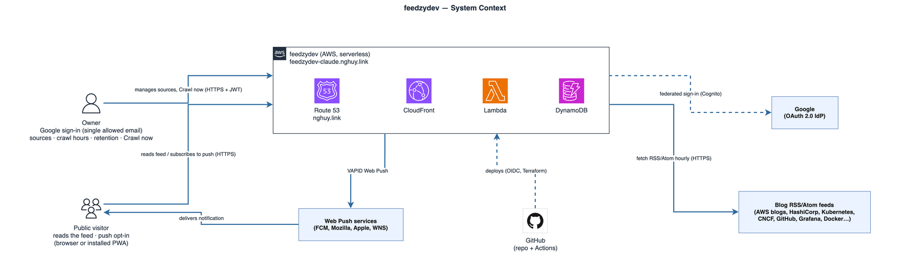
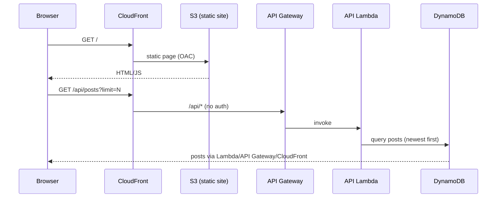
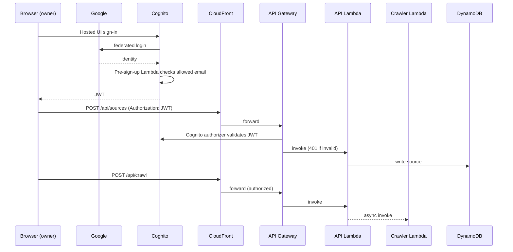
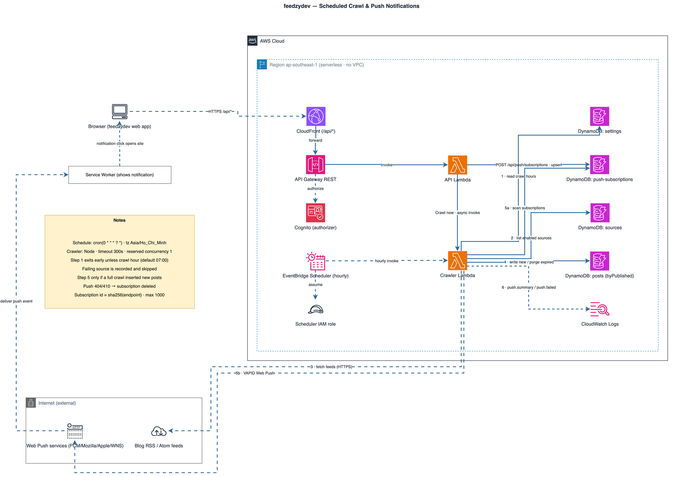
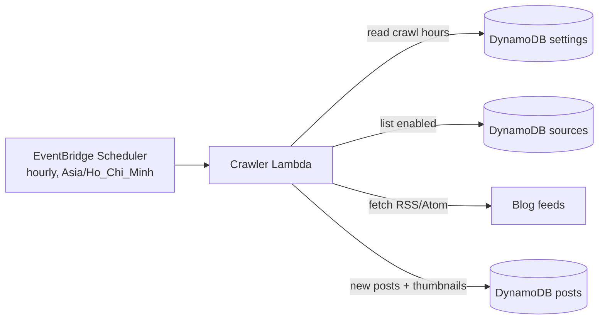
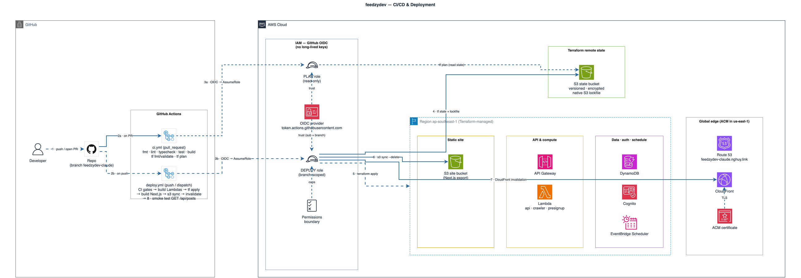
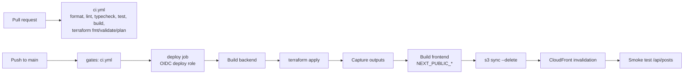
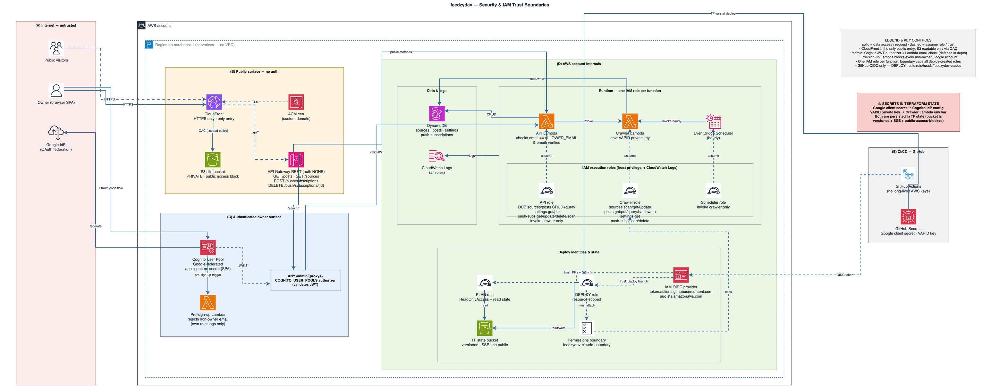

# Architecture

CloudFront is the single entry point (custom domain `feedzydev-claude.nghuy.link`,
ACM certificate in us-east-1). The default behavior serves the Next.js static
export from a private S3 bucket (OAC); `/api/*` forwards to API Gateway, so the
frontend is same-origin with the API and needs no CORS.

## System context

Who uses feedzydev and which outside systems it depends on.



Source: [`diagrams/system-context.drawio`](diagrams/system-context.drawio).

## AWS architecture


Source: [`diagrams/aws-architecture.drawio`](diagrams/aws-architecture.drawio) (open in draw.io).

## Services

| Concern | Service | Role |
|---|---|---|
| Edge / entry | CloudFront + ACM + Route 53 | HTTPS, custom domain, routes static vs `/api/*` |
| Static hosting | S3 (private, OAC) | Next.js static export |
| API | API Gateway REST | Public GETs; write methods behind a Cognito authorizer |
| API compute | Lambda (single function, internal router) | Sources CRUD, posts list, "Crawl now" |
| Crawler | Lambda | Fetches feeds, extracts thumbnails, writes posts |
| Schedule | EventBridge Scheduler | `cron(0 * * * ? *)` (hourly), Asia/Ho_Chi_Minh; the crawler runs only at the crawl hours saved in settings (default 07:00) |
| Data | DynamoDB (sources, posts, settings, push-subscriptions) | On-demand billing |
| Push | Web Push (VAPID) via the `web-push` npm package | Crawler notifies anonymous subscribers after full crawls with new posts |
| Auth | Cognito + Google IdP | Pre-sign-up Lambda allows only the owner's email |
| CI/CD | GitHub Actions + OIDC | Plan role (read-only) and deploy role (branch-scoped) |
| State | S3 (native lockfile) | Terraform remote state |

## Data model

Four DynamoDB tables (`feedzydev-claude-<name>`), all on-demand. There are no joins: each post
copies its `sourceName` so the feed renders from one query.

| Table | Partition key | Sort key | Key value | PITR |
|---|---|---|---|---|
| `sources` | `sourceId` (S) | — | ULID | yes |
| `posts` | `postId` (S) | — | sha256 of the normalized article URL (dedupes re-crawls) | no |
| `settings` | `id` (S) | — | always `"global"` (single item) | yes |
| `push-subscriptions` | `id` (S) | — | sha256 of the push endpoint | no |

Indexes on `posts` (both project `ALL`):

| GSI | Partition key | Sort key | Purpose |
|---|---|---|---|
| `byPublished` | `feedKey` (always `"ALL"`) | `publishedAt` | Whole feed, newest first; retention purge (`publishedAt < cutoff`) |
| `bySource` | `sourceId` | `publishedAt` | One source's posts, newest first; delete posts of a removed source |

`posts` also has a TTL on `expiresAt`, kept only for older items; retention is now enforced by the
crawler's purge. The single `feedKey` partition is fine at this scale (one owner, hundreds of posts)
but would become a hot partition if the feed grew by orders of magnitude.

### Items

| Table | Attributes |
|---|---|
| `sources` | `name`, `siteUrl`, `feedUrl`, `iconUrl?`, `enabled`, `createdAt`, `postsPerSource?` (override), `lastCrawledAt?`, `lastStatus?` (`ok`/`error`), `lastError?` (≤ 500 chars), `lastNewCount?` |
| `posts` | `url`, `title`, `author?`, `publishedAt`, `thumbnailUrl?`, `sourceId`, `sourceName`, `feedKey`, `crawledAt`, `expiresAt?` |
| `settings` | `postsPerSource`, `crawlHours` (local hours 0–23, empty = off), `retentionDays` (0 = keep forever), `updatedAt?` |
| `push-subscriptions` | `endpoint`, `p256dh`, `auth`, `createdAt`, `updatedAt` |

### Access patterns

| Pattern | Caller | Operation |
|---|---|---|
| List the feed (paged, optional `since`) | API | Query `byPublished`, `feedKey = "ALL"`, descending |
| List one source's posts | API | Query `bySource`, `sourceId = :s`, descending |
| Search titles / source names | API | Query the same index page by page and filter in Lambda (no substring index; scan is capped) |
| Insert a new post if not seen | Crawler | Conditional `PutItem` on `postId` |
| Purge expired posts | Crawler | Query `byPublished` with `publishedAt < cutoff`, then `BatchWriteItem` deletes |
| Delete a source and its posts | API | `DeleteItem` on `sources`; Query `bySource` + `BatchWriteItem` on `posts` |
| List sources / enabled sources | API, Crawler | `Scan` `sources` (small table) |
| Record a crawl result | Crawler | `UpdateItem` `lastStatus`, `lastNewCount`, `lastCrawledAt`, `lastError` |
| Read / save settings | Crawler (read), API (read/write) | `GetItem` / `PutItem` `id = "global"` |
| Subscribe (idempotent upsert) | API | `UpdateItem` keyed by endpoint hash, `createdAt = if_not_exists` |
| Enforce the 1000-subscription cap | API | `Scan` with `Select: COUNT` |
| Unsubscribe / prune gone endpoints | API / Crawler | `DeleteItem` (crawler on push 404/410) |
| Fan out a push | Crawler | `Scan` `push-subscriptions` |

## Runtime

### Feed read (public)



### Admin write (authorizer)



### Scheduled crawl



Source: [`diagrams/crawl-and-push.drawio`](diagrams/crawl-and-push.drawio). Covers this section and
[Push notification](#push-notification).



The scheduler fires every hour; the crawler exits early unless the current hour is one of the
crawl hours saved in settings (editable from the UI, default 07:00). A failing source is recorded
and skipped; it never aborts the whole crawl.

### Push notification

```mermaid
sequenceDiagram
    participant B as Browser / PWA
    participant API as API Lambda
    participant DS as DynamoDB push-subscriptions
    participant CR as Crawler Lambda
    participant PS as Push service (FCM, Mozilla, Apple, WNS)
    participant SW as Service worker
    B->>API: POST /api/push/subscriptions (bell click, after permission)
    API->>DS: upsert id = sha256(endpoint)
    Note over CR: full crawl (scheduled or "Crawl now") inserted new posts
    CR->>DS: Scan subscriptions
    CR->>PS: VAPID-signed push (newest post title, count)
    PS-->>CR: 404/410 → delete subscription
    PS->>SW: push event
    SW->>B: showNotification; click focuses or opens /
```

Single-source crawls never notify. Endpoints are limited to known push services, the table is
capped at 1000 subscriptions, and push failures are logged (`push.summary`, `push.failed`) without
affecting the crawl.

## Deploy



Source: [`diagrams/cicd-deploy.drawio`](diagrams/cicd-deploy.drawio).



## Security

Trust zones, IAM roles and where the secrets live.



Source: [`diagrams/security-iam.drawio`](diagrams/security-iam.drawio).

- **Single public entry.** Only CloudFront (HTTPS, ACM) is public. The site bucket blocks public
  access and is readable only by this distribution via OAC.
- **Two API surfaces.** `GET /posts`, `GET /sources` and the push subscribe/unsubscribe routes are
  open. `ANY /admin/{proxy+}` requires a Cognito JWT, and the API Lambda also checks that the token's
  email equals `ALLOWED_EMAIL` and is verified.
- **Owner-only sign-in.** Cognito federates with Google; the pre-sign-up Lambda rejects every other
  email. The app client is public (no secret, OAuth code flow).
- **Least-privilege runtime roles.** Each Lambda and the scheduler has its own role, scoped to the
  tables and actions it uses (see `infra/envs/prod/main.tf`). The scheduler can only invoke the crawler.
- **No long-lived AWS keys in CI.** GitHub Actions assumes roles via OIDC. The plan role
  (read-only + state read) trusts PRs and the deploy branch. The deploy role trusts only
  `refs/heads/main` and can create roles only if they carry the
  `feedzydev-claude-boundary` permissions boundary.
- **Secrets.** The Google client secret and the VAPID private key are GitHub secrets passed to
  Terraform. They end up in the Cognito IdP config and the crawler's environment, and so also in
  Terraform state. That makes the state bucket (versioned, encrypted, public access blocked)
  sensitive.
