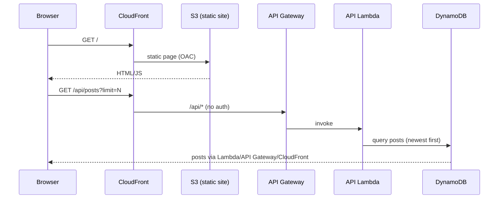
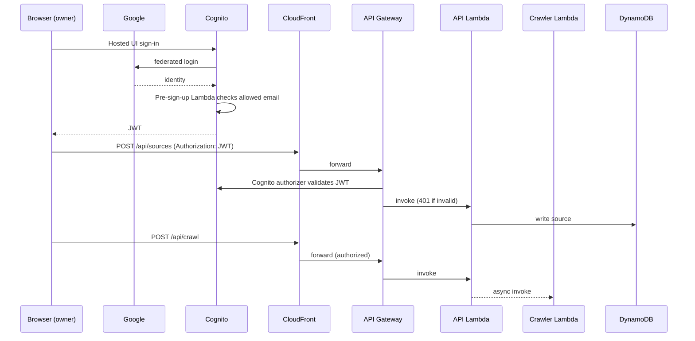
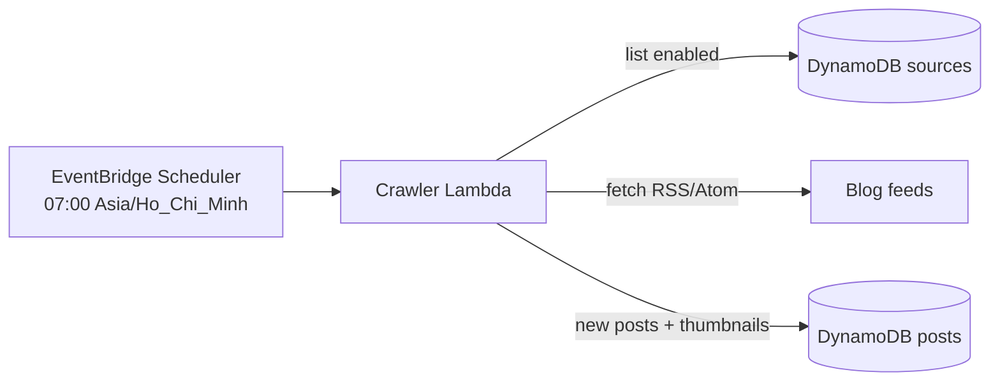
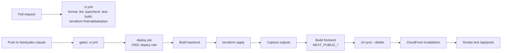

# Architecture

CloudFront is the single entry point (custom domain `feedzydev-claude.nghuy.link`,
ACM certificate in us-east-1). The default behavior serves the Next.js static
export from a private S3 bucket (OAC); `/api/*` forwards to API Gateway, so the
frontend is same-origin with the API and needs no CORS.

## Services

| Concern | Service | Role |
|---|---|---|
| Edge / entry | CloudFront + ACM + Route 53 | HTTPS, custom domain, routes static vs `/api/*` |
| Static hosting | S3 (private, OAC) | Next.js static export |
| API | API Gateway REST | Public GETs; write methods behind a Cognito authorizer |
| API compute | Lambda (single function, internal router) | Sources CRUD, posts list, "Crawl now" |
| Crawler | Lambda | Fetches feeds, extracts thumbnails, writes posts |
| Schedule | EventBridge Scheduler | `cron(0 7 * * ? *)`, Asia/Ho_Chi_Minh |
| Data | DynamoDB (sources, posts) | On-demand billing |
| Auth | Cognito + Google IdP | Pre-sign-up Lambda allows only the owner's email |
| CI/CD | GitHub Actions + OIDC | Plan role (read-only) and deploy role (branch-scoped) |
| State | S3 (native lockfile) | Terraform remote state |

## Runtime

### Feed read (public)

### Admin write (authorizer)

### Scheduled crawl

A failing source is recorded and skipped; it never aborts the whole crawl.

## Deploy

