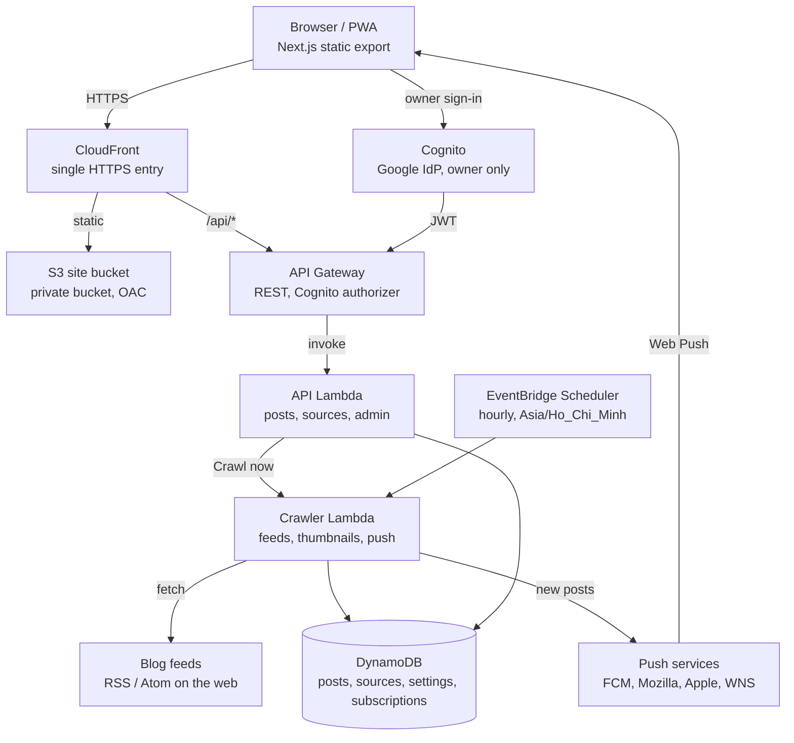

# Tech stack

As of 2026-10-28.

## At a glance

feedzydev is a serverless AWS app. A Next.js static site and a Lambda API share one CloudFront domain, a scheduled crawler fills DynamoDB from blog feeds, and Terraform plus GitHub Actions provision and deploy it all.



Reads are public and go CloudFront → API Gateway → API Lambda → DynamoDB. Owner writes also pass the Cognito authorizer, and the crawler pushes notifications to subscribed browsers after it finds new posts.

## Frontend

The frontend is a Next.js app exported as static files (`output: 'export'`), served from S3 behind CloudFront and calling the API on the same origin under `/api/*`.

| Area          | Choice                                                     | Notes                                                                  |
| ------------- | ---------------------------------------------------------- | ---------------------------------------------------------------------- |
| Framework     | Next.js 15 (App Router), React 19                          | Static export, `trailingSlash: true`, unoptimized images               |
| Language      | TypeScript 6                                               | `tsc --noEmit` in CI                                                   |
| Styling       | Tailwind CSS 4 (`@tailwindcss/postcss`)                    | Theme tokens and light/dark toggle; custom animations in `globals.css` |
| Auth          | AWS Amplify 6 + Cognito Hosted UI                          | Google sign-in for the owner only; JWT sent on admin calls             |
| PWA           | `manifest.json`, service worker `sw.js`                    | Installable; receives Web Push and opens the feed on click             |
| Pages         | `/` (feed), `/sources` (owner admin)                       | Feed has search, source and date filters, infinite scroll              |
| Loading UX    | Branded splash on first load; same loader on search/filter | Minimum visible time, honors `prefers-reduced-motion`                  |
| Mock mode     | `NEXT_PUBLIC_MOCK=1`                                       | Runs the UI on built-in mock data, no AWS needed                       |
| Testing       | Vitest 5, Testing Library, jsdom                           | Component, hook and lib tests under `frontend/test`                    |
| Lint / format | ESLint 10 (`eslint-config-next`), Prettier 3               | Shared Prettier config at repo root                                    |

## Backend

The backend is three TypeScript Lambda functions on Node.js 24 (arm64), bundled with esbuild and storing everything in DynamoDB.

| Function                      | Trigger                                                                                                                        | Job                                                                                                                                                                       | Limits                                        |
| ----------------------------- | ------------------------------------------------------------------------------------------------------------------------------ | ------------------------------------------------------------------------------------------------------------------------------------------------------------------------- | --------------------------------------------- |
| API (`src/api`)               | API Gateway REST, proxied at `/api/*`                                                                                          | One function with an internal router: posts list and search, public sources, push subscribe/unsubscribe, owner-only `/admin` routes (sources CRUD, settings, "Crawl now") | 29 s timeout, 256 MB                          |
| Crawler (`src/crawler`)       | EventBridge Scheduler hourly (runs only at the crawl hours saved in settings, default 07:00), or async invoke from "Crawl now" | Fetches RSS/Atom feeds, extracts thumbnails, writes new posts, applies retention, sends Web Push                                                                          | 300 s timeout, 512 MB, reserved concurrency 1 |
| Pre-sign-up (`src/presignup`) | Cognito trigger                                                                                                                | Rejects any Google account except the allowed owner email                                                                                                                 | 5 s timeout                                   |

**Data (DynamoDB, on-demand billing):**

| Table                | Key                     | Indexes / extras                                                                                               |
| -------------------- | ----------------------- | -------------------------------------------------------------------------------------------------------------- |
| `posts`              | `postId`                | GSIs `byPublished` (`feedKey` + `publishedAt`) and `bySource` (`sourceId` + `publishedAt`); TTL on `expiresAt` |
| `sources`            | `sourceId`              | Point-in-time recovery                                                                                         |
| `settings`           | `id`                    | Posts per source, crawl hours, retention days; point-in-time recovery                                          |
| `push-subscriptions` | `id` = sha256(endpoint) | Capped at 1000 subscriptions                                                                                   |

**Key libraries:** AWS SDK v3 (`client-dynamodb`, `lib-dynamodb`, `client-lambda`), `fast-xml-parser` (feeds), `node-html-parser` (feed discovery, thumbnails), `ulid` (ids), `web-push` (VAPID notifications).

**Quality:** Jest 30 with `ts-jest` and `aws-sdk-client-mock`; ESLint 10 with `typescript-eslint`; Prettier 3.

## Infrastructure

Everything runs serverless on AWS in `ap-southeast-1`, provisioned with Terraform (AWS provider ~> 6.0, Terraform 1.15.5 in CI), so idle cost stays near zero.

| Concern         | AWS service                           | Details                                                                                                                                                          |
| --------------- | ------------------------------------- | ---------------------------------------------------------------------------------------------------------------------------------------------------------------- |
| Edge and domain | CloudFront, ACM (us-east-1), Route 53 | `feedzydev-claude.nghuy.link`; `/api/*` goes to API Gateway, everything else to S3; a CloudFront Function rewrites paths for the static export; `PriceClass_200` |
| Static hosting  | S3 (private, Origin Access Control)   | Hashed assets cached 1 year (immutable), HTML `no-cache`                                                                                                         |
| API             | API Gateway REST                      | Public GETs; writes behind a Cognito authorizer; throttled at 10 req/s, burst 20                                                                                 |
| Compute         | Lambda (Node.js 24, arm64)            | API, crawler, Cognito pre-sign-up                                                                                                                                |
| Scheduling      | EventBridge Scheduler                 | `cron(0 * * * ? *)` in `Asia/Ho_Chi_Minh`                                                                                                                        |
| Data            | DynamoDB (on-demand)                  | 4 tables, see [Backend](#backend)                                                                                                                                |
| Auth            | Cognito user pool + Google IdP        | Hosted UI; pre-sign-up Lambda allows one email                                                                                                                   |
| Terraform state | S3 backend with native lockfile       | Bucket and CI roles created by `infra/bootstrap`                                                                                                                 |

**Terraform layout:**

- `infra/bootstrap`: state bucket, GitHub OIDC plan role (read-only) and deploy role (branch-scoped), permissions boundary.
- `infra/envs/prod`: the live environment, composed from modules.
- `infra/modules`: `api`, `auth`, `certificate`, `data`, `frontend`, `lambda`, `schedule`.

## Automation

GitHub Actions runs every gate on pull requests and deploys on each push to `main`. It reaches AWS through OIDC roles, so the repo holds no long-lived AWS keys.

| Workflow     | Trigger                                                         | What it does                                                                                                                                                                                                                                                                      |
| ------------ | --------------------------------------------------------------- | --------------------------------------------------------------------------------------------------------------------------------------------------------------------------------------------------------------------------------------------------------------------------------- |
| `ci.yml`     | Pull request to `main`, manual, or called by Deploy             | Backend and frontend jobs: install (frozen lockfile), Prettier check, ESLint, typecheck, tests, build. Terraform job: `fmt -check`, `validate` for bootstrap and prod, then `terraform plan` with the read-only role when `infra/**` or `backend/**` changed (same-repo PRs only) |
| `deploy.yml` | Push to `main`, or manual                                       | Runs `ci.yml` as its gate, then deploys with the deploy role; one deploy at a time (`concurrency` group, no cancel)                                                                                                                                                               |

**Deploy steps:**

1. Build the backend bundles with esbuild.
2. `terraform apply` for `infra/envs/prod`, with secrets passed as `TF_VAR_*`.
3. Read Terraform outputs (Cognito ids, bucket, distribution id).
4. Build the frontend with those `NEXT_PUBLIC_*` values.
5. Sync `_next/static` to S3 as immutable, then the rest with `--delete` and `no-cache`.
6. Invalidate CloudFront.
7. Smoke-test `/api/posts`.

**Runtime automation:** the EventBridge schedule triggers the crawler hourly. After a full crawl that finds new posts, the crawler sends Web Push notifications and deletes subscriptions that return 404/410.

**Secrets and variables:** `AWS_PLAN_ROLE_ARN`, `AWS_DEPLOY_ROLE_ARN`, `GOOGLE_CLIENT_ID`, `GOOGLE_CLIENT_SECRET` and `VAPID_PRIVATE_KEY` are secrets. `AWS_REGION`, `STATE_BUCKET_NAME`, `ALLOWED_EMAIL` and `VAPID_PUBLIC_KEY` are plain variables. A deploy fails if the VAPID keys are missing.

## Local development

`frontend` and `backend` are separate pnpm packages with no root `package.json`, so run commands inside each one. Node 24 is pinned in `.nvmrc`, and the pnpm version in each `packageManager` field.

```bash
# UI on mock data, no AWS needed
cd frontend && pnpm install && NEXT_PUBLIC_MOCK=1 pnpm dev

# Same gates as CI
(cd backend  && pnpm install --frozen-lockfile && pnpm format:check && pnpm lint && pnpm typecheck && pnpm test && pnpm build)
(cd frontend && pnpm install --frozen-lockfile && pnpm format:check && pnpm lint && pnpm typecheck && pnpm test)
terraform fmt -check -recursive infra
```

To run against a real backend, set `NEXT_PUBLIC_USER_POOL_ID`, `NEXT_PUBLIC_USER_POOL_CLIENT_ID`, `NEXT_PUBLIC_COGNITO_DOMAIN` and `NEXT_PUBLIC_VAPID_PUBLIC_KEY` (see `frontend/.env.example`). Never set `NEXT_PUBLIC_MOCK` in CI or deploy builds. First-time setup is in the [go-live runbook](runbooks/go-live.md), and the sequence diagrams are in [architecture.md](architecture.md).
